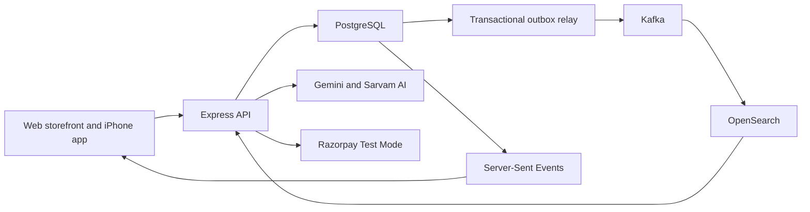

# Nukkad

Nukkad lets shoppers check what’s in stock at neighborhood stores, compare shopping baskets, and order for pickup or local delivery. Shopkeepers manage online orders and counter sales against the same stock.

**[Try Nukkad](https://nukkadshop.vercel.app/)**


## Features

| For shoppers | For shopkeepers |
| --- | --- |
| Browse nearby products and search with filters such as `earphones under 2k`. | Manage listings, prices, and shelf stock. |
| Ask the multilingual shopping assistant to compare single-store and split baskets. Use GPS or choose an area manually. | Record counter sales and prepare pickup or delivery orders. |
| Reserve and pay at pickup, or pay online with Razorpay Test Mode. Track orders and view pickup codes in **My orders**. | Verify pickup codes and inspect committed inventory and order changes. |

PostgreSQL row locks prevent online shoppers and counter sales from claiming the same last item. The backend records events in a transactional outbox and uses Kafka and OpenSearch for search synchronization. The storefront receives live updates through Server-Sent Events.

**[Watch the race condition demo](https://drive.google.com/file/d/1GLget8BKAD_mgYIvyrhaKcRfIXkJz6vy/view?usp=sharing)** — Two shoppers try to buy the last loaf. One completes a test payment while the other gets an out-of-stock message.

## How it works



## Run locally

Requires Node.js 20+, npm, and PostgreSQL.

```bash
npm ci --prefix backend
npm ci --prefix frontend
cp -n backend/.env.example backend/.env
```

Enter your database settings in `backend/.env`. For local PostgreSQL without TLS, set `PG_SSL=false`. Set `KAFKA_ENABLED=false` and `OPENSEARCH_ENABLED=false` if you’re running without those services. The assistant uses Gemini and Sarvam, and online checkout needs Razorpay Test Mode keys. See [environment settings](backend/.env.example).

Run these in separate terminals:

```bash
npm run dev --prefix backend
npm run dev --prefix frontend
```

Open the URL Vite prints, usually `http://localhost:3000`. To populate a private demo database, run `npm run seed --prefix backend` after the API starts.

## iPhone app

Run `sh ios/build-storefront.sh`, then open `ios/Nukkad.xcodeproj`. Select your signing team and iPhone in Xcode and press **Run**. The app uses the hosted API by default. Set `NUKKAD_API_URL` before rebuilding to use a different HTTPS backend.

## Build and test

```bash
npm --prefix backend test
npm --prefix frontend run build
```

Set `TEST_DATABASE_URL` to a local PostgreSQL database to include integration tests.

The web app is hosted on **Vercel**, the API on **Render**, and PostgreSQL, Kafka, and OpenSearch on **Aiven**. The Vercel build uses `VITE_API_BASE_URL` for the public API URL. Keep service keys in the backend environment.

Built by **Team LastMinute**.
