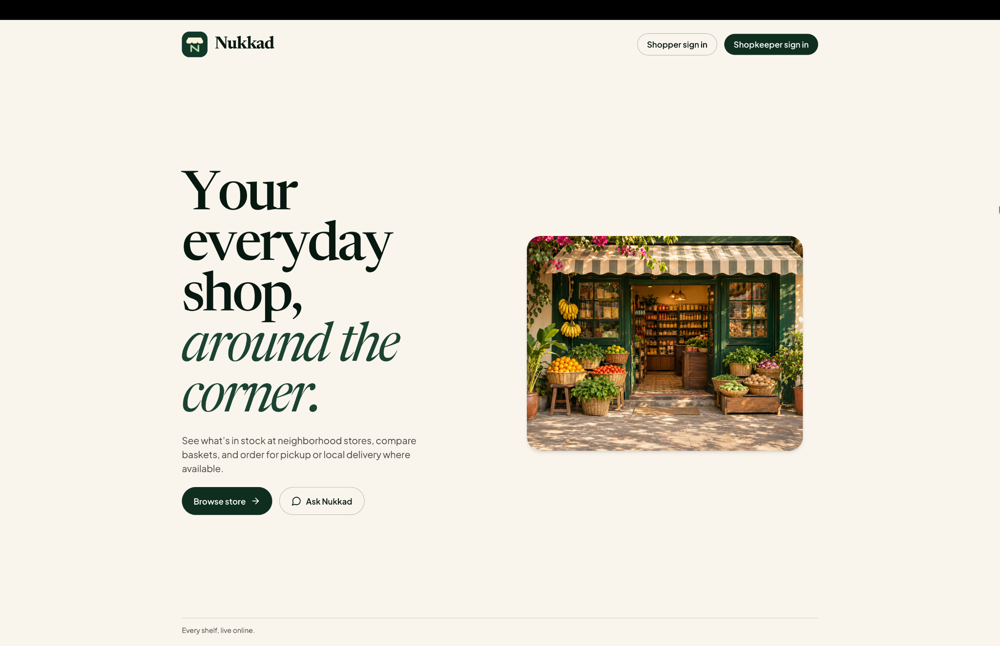
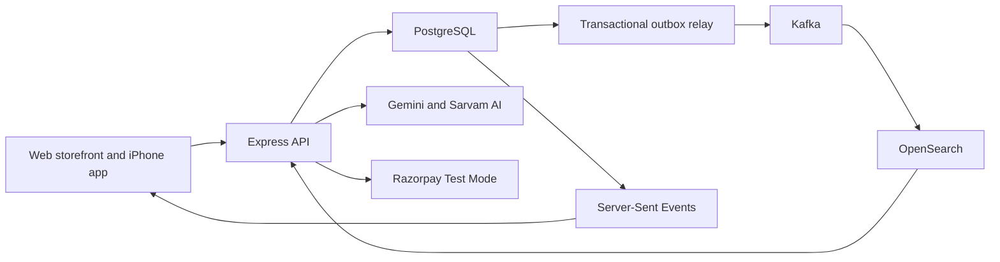

# Nukkad

**A neighborhood storefront with live inventory, multilingual basket planning, and store-level order fulfilment.**

[Browse Nukkad](https://nukkadshop.vercel.app/)



Nukkad brings the physical shelf and the online shop together. A merchant can record an in-store sale while a shopper is checking out, and both operations use the same inventory record. Shoppers can also describe an entire shopping list in chat, see how much nearby shops can fulfil, and choose between a single shop and a split pickup.

## Shopper experience

### Browse and search

- **Live catalogue.** Product cards show the selling store, unit size, price, and available quantity. The catalogue covers groceries, produce, pantry staples, snacks, and electronics. Merchants can set their own price, name, unit, and stock for a listing.
- **Natural-language filters.** Try `earphones under 2k` or `rice at most ₹500`. Category, minimum and maximum price, in-stock filtering, and price sorting combine with the search text.
- **Nearby listings.** When location is available, the storefront prioritizes nearby in-stock listings. Without location, it can still show listings from across the catalogue.
- **Single-store cart.** An ordinary checkout belongs to one store. If an item is offered by another shop, Nukkad looks for an equivalent listing at the cart’s store and shows the actual price there. If there’s no match, the existing cart stays intact.

### Nukkad Assistant and basket comparison

Open the chat bubble on the storefront or select **Ask Nukkad** on the landing page. Sign in as a shopper and send a request such as `2 milk and bread`. Follow up with a change such as `make that 3 milk` to revise the list.

1. **Understand the request.** Gemini extracts quantities and product names in a structured format. The backend validates the response before sending it to the planner.
2. **Support regional languages.** The assistant supports English, Hindi, Kannada, Tamil, Telugu, and Malayalam, plus automatic language detection. Sarvam AI translates supported non-English requests for catalogue matching and translates replies back. Voice input and **Read aloud** use the speech features available on the device or browser.
3. **Choose a location.** Use GPS, type a locality, city, address or PIN, or select a suggested area. The current clients can open the location picker after the shopper taps **Send**. If there are no nearby matches, the shopper can try another location without retyping the list. GPS searches active stores within 10 km using straight-line distance. A typed location can use a matching store’s coordinates as an approximate starting point. Distances are shown when available.
4. **Compare actual baskets.** PostgreSQL supplies current listings, prices and available stock. Each result lists the shop, items, quantities, subtotal, available distance estimate, and missing items. A complete multi-store option appears when the planner finds one.

The planner evaluates single-store baskets and complete splits across two or three shops, using up to 12 eligible stores for split candidates. It ranks by fewer missing item types, then more units filled, then score. The score adds ₹8 per known straight-line kilometre and ₹25 per additional stop to the basket price. These weights only affect ranking. The displayed basket subtotal is what the products cost.

### Checkout, payment and fulfilment

| Option | What happens |
| --- | --- |
| **Buy now** | The backend checks current stock and, for a planned basket, the quoted price before holding inventory and creating a hosted Razorpay Test Mode payment link. A split basket checks out one store at a time. |
| **Reserve for pickup** | The shopper can reserve a single-store or split basket and pay at collection. A split reservation creates a separate order per store in one database transaction. A stock or price conflict rolls back the full reservation, and repeating the same request key prevents duplicate orders. |
| **Local delivery** | The regular cart supports delivery to the selected store’s service PIN and adds a ₹30 delivery fee in the current implementation. Availability depends on the store. |

- **Online payment:** Unpaid Razorpay holds last 20 minutes. Shoppers can resume, check, or cancel an eligible payment from **My orders**. The backend polls for payment and checks the gateway before releasing a hold. An eligible cancellation or expiry restores stock once.
- **Pickup:** A merchant can accept a pay-at-pickup request, mark it ready, and collect it using the shopper’s six-digit code. Paid online pickup also supports preparation and collection with a code, and shows a two-hour pickup window when marked ready.
- **Delivery:** The merchant can mark a paid order **Preparing**, **Out for delivery**, and **Delivered**. Eligible merchant cancellation of a paid order can restore stock and mark the payment **Refund pending** for manual handling.
- **Order tracking:** **My orders** shows the shopper’s own orders, payment and fulfilment state, and applicable pickup instructions. Customer and merchant views refresh after server-side changes.

## Merchant console

Shoppers and shopkeepers use separate sign-in flows. A merchant can register a store with its location and PIN. Merchant operations are scoped to the signed-in merchant’s store, and customers only receive access to their own orders.

| Area | What merchants can do |
| --- | --- |
| **Shelf stock** | See listing quantities and low-stock indicators, restock inventory, and correct shelf counts. |
| **Manage listings** | Add a product or reuse a catalogue entry, set its store-specific name, unit, price and quantity, and list or unlist it. Unlisting preserves existing reservations and history. |
| **Counter sales** | Record a physical sale against the same available stock used by online checkout and reservations. |
| **Incoming orders** | Accept or reject reservation requests, prepare orders, validate pickup codes and update delivery status. |
| **Database changes** | Inspect committed inventory and order changes with before/after values. Private checkout demos exercise the same services with dedicated inventory and simulated payments. |

## How it works



- **PostgreSQL is the source of truth.** Online holds, pickup reservations, and counter sales lock the same inventory rows using `SELECT ... FOR UPDATE`. If two orders compete for the last unit, the first successful transaction claims it. The second sees the updated stock.
- **The transactional outbox ties events to committed writes.** Stock and order changes insert outbox records in the same transaction. The relay publishes them to Kafka topics such as `store.orders` and `store.inventory` for asynchronous processing, including search synchronization.
- **Search combines current inventory with optional typo matching.** PostgreSQL applies listing, stock, price and category constraints. OpenSearch can supply fuzzy product candidates when an exact search doesn’t match.
- **Live updates reach clients via SSE.** PostgreSQL notifications support stock and order refreshes even when Kafka and OpenSearch are disabled for local development.
- **The iPhone app bundles the storefront.** SwiftUI and WKWebView host the React bundle. The app uses native iOS location for the assistant and calls the HTTPS backend for inventory, accounts, orders and payments.

**Stack** · React, TypeScript, Vite, Tailwind CSS, Node.js, Express, PostgreSQL, KafkaJS, Apache Kafka, OpenSearch, SwiftUI and WKWebView. The public web build is on Vercel, the API is on Render, and the data services use Aiven.

## Run locally

Use Node.js 20 or newer with npm. You’ll also need a PostgreSQL database. From the repository root:

```bash
npm ci --prefix backend
npm ci --prefix frontend
cp -n backend/.env.example backend/.env
```

Edit `backend/.env` using [the example configuration](backend/.env.example). The copy command preserves an existing file.

| Configuration | Needed for |
| --- | --- |
| `PG_HOST`, `PG_PORT`, `PG_USER`, `PG_PASSWORD`, `PG_DATABASE`, `PG_SSL` | Core accounts, inventory, orders and planning. For a local PostgreSQL server without TLS, use `PG_SSL=false`. |
| `JWT_SECRET` | Set a unique secret for shared or hosted deployments. |
| `KAFKA_ENABLED`, `OPENSEARCH_ENABLED` | Aiven streaming and fuzzy search. Set both to `false` for a PostgreSQL-only setup. When enabled, supply the corresponding broker, TLS and search credentials. |
| `GEMINI_API_KEY`, `GEMINI_MODEL`, `SARVAM_API_KEY` | Assistant conversation and translation. English mode uses Gemini directly. Automatic detection and other language modes also use Sarvam. |
| `RAZORPAY_KEY_ID`, `RAZORPAY_KEY_SECRET` | Online checkout via hosted Razorpay **Test Mode** links. Pay-at-pickup reservations work independently of the gateway. |
| `ENABLE_DEMO_ACCOUNTS`, `VITE_ENABLE_DEMO_ACCOUNTS` | Optional seeded logins and demo controls on a private demo database only. Set the former in the backend environment and the latter in the frontend environment. |

Start the backend before seeding so it can apply its migrations.

```bash
# Terminal 1
npm run dev --prefix backend

# Terminal 2, optional, after the backend is ready
npm run seed --prefix backend

# Terminal 3
npm run dev --prefix frontend
```

Open the URL printed by Vite, usually `http://localhost:3000`. The development frontend proxies API requests to `http://localhost:5001`. Seed only a disposable or private demo database, since the seed command populates sample accounts, products and stock.

## Run the iPhone app

1. From the repository root, install the frontend packages and build the bundled storefront.

   ```bash
   npm ci --prefix frontend
   sh ios/build-storefront.sh
   open ios/Nukkad.xcodeproj
   ```

2. In Xcode, choose your Apple development team under **Signing & Capabilities**.
3. Select your iPhone as the run destination and press **Run**. Use **Allow While Using App** if you want to use GPS. You can also pick an area manually.
4. Rebuild the bundle and rerun the app when changing the frontend. To target a different backend, run `NUKKAD_API_URL=https://your-api.example.com sh ios/build-storefront.sh`. The default is the live Render backend. The iPhone app uses its bundled web assets and needs network access for API calls.

## Deployment

| Service | Configuration |
| --- | --- |
| **Vercel** | [Live storefront](https://nukkadshop.vercel.app/). The current deployment was uploaded as a built `dist` bundle. To update it, build with `VITE_API_BASE_URL` set to the HTTPS API and upload the new bundle with the SPA rewrite from [frontend/vercel.json](frontend/vercel.json). For a Git-connected deployment, set the root directory to `frontend`, build command to `npm run build`, and output directory to `dist`. |
| **Render** | The current service tracks `updates`. Use root directory `backend`, build command `npm ci --include=dev && npm run build`, and start command `npm start`. Configure database, payment and assistant secrets in Render’s backend environment. |
| **Aiven** | Hosts PostgreSQL, Kafka and OpenSearch. Keep credentials and certificates in the backend environment. |

Leave demo-account flags off on public deployments. Keep Gemini, Sarvam, Razorpay and database secrets on the server. Vercel only needs the public API base URL.

## Demo walkthrough

### Split pickup

1. Register two merchants in **Demo Lane, Bengaluru**, PIN **560095**. Use **Milk Shop** and **Bread Shop** with demo coordinates **12.93, 77.62**.
2. Add **2 cartons of milk at ₹40 each** to Milk Shop and **1 loaf of bread at ₹30** to Bread Shop.
3. Sign in as a shopper. Ask Nukkad for `2 milk and bread`, pick **Demo Lane**, and compare. Each single store has a missing item. The complete split totals **₹110**.
4. Reserve the split for pickup. Accept, mark ready, and collect the milk order with its pickup code. Reject or cancel the bread order to see its quantity restored once.
5. Repeat with **Buy now** and Razorpay Test Mode to demonstrate one-store-at-a-time online payment.

### Last-unit race

1. Set a listed test item’s available stock to **1** in a private demo store.
2. Have two shopper accounts attempt the same reservation, or race one shopper checkout against a counter sale.
3. One succeeds. The other receives a stock conflict. Inspect the committed inventory change in the merchant dashboard.

## Routes and API

| Screen | Route |
| --- | --- |
| Landing page | `/` |
| Storefront and assistant | `/shop` and `/shop?chat=open` |
| Shopper sign-in and registration | `/login` |
| My orders | `/orders` |
| Merchant sign-in and registration | `/store/login` and `/store/signup` |
| Merchant dashboard | `/store/dashboard` |

| API | Purpose |
| --- | --- |
| `GET /api/products/search`, `GET /api/categories`, `POST /api/stores/nearby` | Browse products, filter the catalogue, and find nearby stores. |
| `POST /api/customer/shopping-assistant`, `POST /api/shopping-plan` | Interpret a chat request or calculate a basket comparison from a list. |
| `POST /api/orders`, `POST /api/customer/pickup-reservations` | Create an online checkout or reserve pickup baskets. |
| `GET /api/customer/orders`, `POST /api/customer/orders/:id/payment` | Read a shopper’s orders, verify payment or cancel an unpaid checkout. |
| `POST /api/inventory/listings`, `PUT /api/inventory/listings/:id`, `POST /api/inventory/counter-sale` | Manage merchant listings and record a physical sale. |
| `PUT /api/orders/:id/status`, `GET /api/dashboard/changes` | Update fulfilment and inspect committed changes. |
| `GET /api/health`, `GET /api/events/live` | Check the service and subscribe to live events. |

## Tests

```bash
npm --prefix backend test
npm --prefix frontend run build
```

Set `TEST_DATABASE_URL` to a local PostgreSQL database before running the backend tests to include the database integration suite. The test user needs permission to create a schema. The suite checks pickup lifecycle, last-unit contention, split rollback, idempotency and order ownership. Assistant tests mock Gemini and Sarvam. Use a configured deployment to verify live provider calls and Razorpay Test Mode.

Built by **Team LastMinute** for the retail and e-commerce track.
